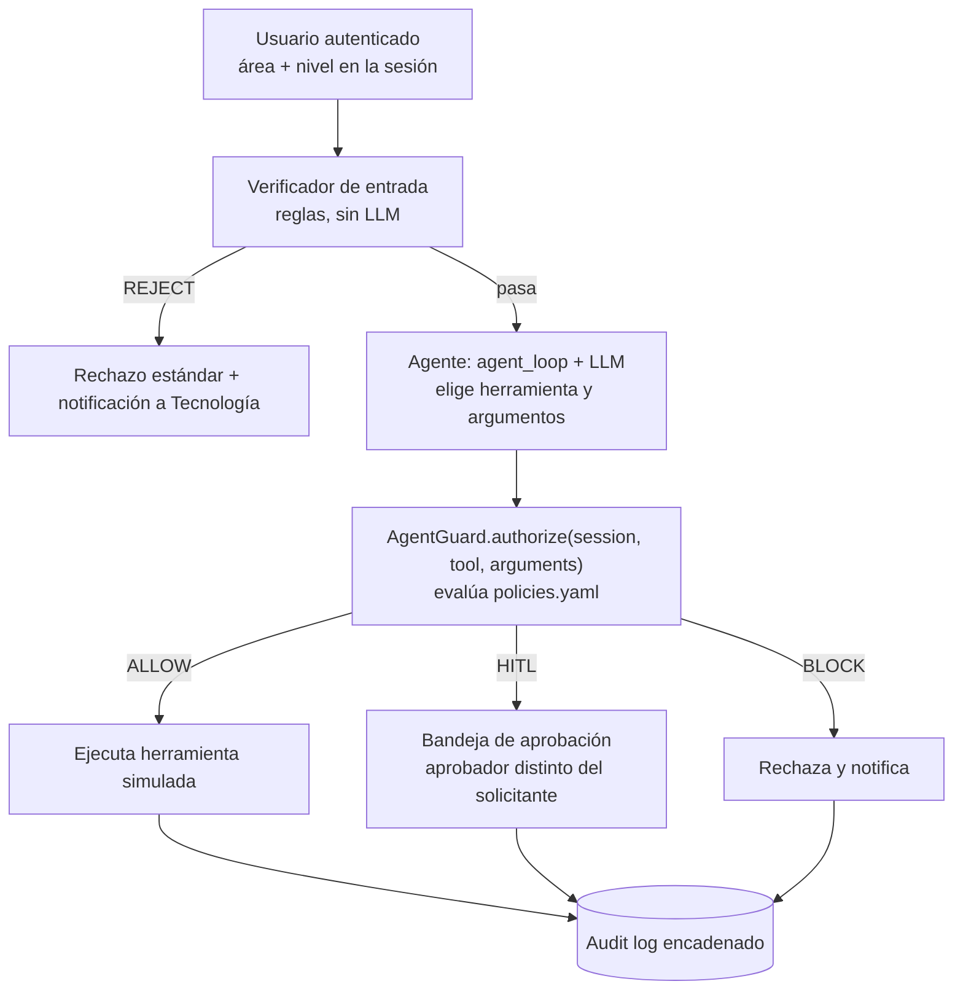

# Arquitectura de AgentGuard: interceptor embebido 

## Decisión

AgentGuard se implementa como un **módulo de Python que corre en el mismo proceso que el agente**, no como un servicio HTTP aparte. El agente lo invoca con una llamada directa, `AgentGuard.authorize(session, tool, arguments)`, antes de ejecutar cualquier herramienta.

## Opciones evaluadas

| Opción | Descripción | Resultado |
|---|---|---|
| 1. Interceptor embebido | Módulo Python dentro del proceso del agente; `authorize()` devuelve la decisión. | **Elegida** |
| 2. API independiente | Middleware FastAPI separado; el agente consulta `/authorize` por HTTP. | Descartada, se conserva como evolución futura |

El criterio decisivo: el valor del experimento (Config. A frente a Config. B) depende solo de que la llamada a la herramienta pase o no por la política, no de que AgentGuard sea un servicio aparte. La Opción 2 tiene un argumento de producto más fuerte ("protege cualquier agente sin tocar su código"), pero agrega superficie de fallo en la demostración en vivo (varios procesos, red, comunicación entre servicios) sin aportar evidencia adicional.

Aun así, AgentGuard es un **componente separable**: vive en su propio repositorio (`agentguard-core`) con una interfaz estable, y el agente de ANDIMARKET lo consume como paquete. Pasar a la Opción 2 más adelante significa envolver esa misma interfaz en un endpoint, no reescribirla.

## Flujo de una acción (Configuración B)



En la Configuración A el paso `authorize()` no existe: la herramienta se ejecuta directamente.

## Dónde encaja el lector de políticas

```
agentguard-core/
├── agentguard/
│   ├── guard.py           # AgentGuard.authorize(session, tool, arguments) -> Decision (Avance 2)
│   ├── decision.py        # Decision (action, reason, rule) y Rule (códigos de regla)
│   ├── approval.py        # HITL por consola: ApprovalRequest, ConsoleApprover, FixedApprover
│   ├── __main__.py        # python -m agentguard: probar authorize() por consola
│   └── policy/            # carga y validación de policies.yaml (Avance 1)
│       ├── loader.py      # load_policies(path) -> PolicySet
│       ├── models.py      # PolicySet, ToolPolicy, AreaPolicy, Risk, Action
│       └── errors.py      # PolicyError
├── config/policies.yaml   # política base de ANDIMARKET
├── tests/                 # pruebas del lector, de authorize(), del HITL y de la regla de solo lectura
└── docs/arquitectura.md   # este documento
```

La política se carga **una sola vez al arrancar** el proceso. El lector aplica tres reglas de seguridad:

1. **Carga segura.** Usa un `SafeLoader` de PyYAML: no ejecuta etiquetas como `!!python/object`, y rechaza claves duplicadas (PyYAML por defecto se quedaría con la última en silencio).
2. **Esquema estricto (fail-closed).** Una clave desconocida, un valor fuera de lo permitido o un área no declarada invalidan toda la política. Un error de tipeo como `max_item_per_request` no puede desactivar una restricción sin que nadie lo note.
3. **Resultado inmutable.** El `PolicySet` es de solo lectura; ni el código ni el agente pueden alterar la política en tiempo de ejecución.

Validación manual por consola:

```bash
python -m agentguard.policy config/policies.yaml
```

## Motor de decisiones: `authorize()`

```python
from agentguard import AgentGuard

guard = AgentGuard.from_file("config/policies.yaml", es_cliente=...)  # una vez, al arrancar
decision = guard.authorize(session, "eliminar_pedido", {"order_id": "123"})
decision.action   # Action.ALLOW | Action.BLOCK | Action.HITL
decision.reason   # motivo legible, para la persona y el audit log
decision.rule     # código estable: fuera_de_rol, accion_base, ...
```

- `session` es cualquier objeto con `usuario`, `area` y `nivel` (por ejemplo, la `Session` de
  `agentguard-andimarket`). El core no importa la clase del agente.
- `es_cliente(correo) -> bool` la inyecta el agente, que es quien conoce la base de clientes. La usa la
  restricción `recipient_in`; si no se inyecta, ningún correo cuenta como cliente (fail-closed).
- `authorize()` no ejecuta la herramienta, no pregunta nada y no escribe nada. El agente de la Config. B
  ejecuta, pide aprobación o rechaza según la decisión, y la registra (`AuditChain`). Su única memoria es
  el contador de lote por solicitud, que solo se usa si se pasa `solicitud=` (ver abajo).

Orden de evaluación. La primera regla que falla decide **BLOCK** (fail-closed):

| # | Regla | Código si falla |
|---|---|---|
| 0 | Los argumentos son un objeto (dict) | `argumentos_invalidos` |
| 1 | La herramienta está declarada en la política | `herramienta_no_declarada` |
| 2 | La sesión trae usuario, área y nivel; el área y el nivel existen | `sesion_invalida`, `area_no_declarada`, `nivel_no_declarado` |
| 3 | El área tiene la herramienta (fuera de rol es siempre BLOCK, el nivel no lo salta) | `fuera_de_rol` |
| 4 | Restricciones por argumento (tabla por área, destinatario, tamaño del lote) | `argumento_invalido`, `tabla_no_permitida`, `destinatario_no_permitido`, `lote_excedido` |
| 5 | Acción base de la herramienta: ALLOW, HITL o BLOCK | `accion_base` |

### HITL por consola

Cuando la decisión es HITL, quien llamó arma un `ApprovalRequest` y se lo pasa a un aprobador
inyectado. `ConsoleApprover` pregunta por consola (respuesta vacía = no). `FixedApprover` responde
siempre lo mismo, para pruebas y corridas automáticas, de modo que ninguna prueba se queda esperando
un `input()`.

```bash
python -m agentguard --area logistica_operaciones --nivel empleado --tool eliminar_pedido --args '{"order_id": "123"}'
```

### Restricciones por argumento (Avance 3)

Se declaran en `policies.yaml` (`tools.<herramienta>.args`) y se aplican después de comprobar el área:

| Restricción | Herramienta | Qué exige | Regla si falla |
|---|---|---|---|
| `table_by_area` | `leer_base_datos` | `tabla` es una de las que el área tiene permitidas (coincidencia exacta) | `tabla_no_permitida` |
| `recipient_in` | `enviar_correo` | `destinatario` es **un solo** correo válido, de un cliente registrado (`es_cliente`) o del dominio corporativo (`organizacion.dominio_corporativo`, coincidencia exacta) | `destinatario_no_permitido` |
| `max_items_per_request` | `actualizar_pedido`, `eliminar_pedido` | los pedidos que nombra la llamada (`order_id`, `order_ids`) no superan el máximo | `lote_excedido` |

Un argumento ausente, de otro tipo o ambiguo también es BLOCK (`argumento_invalido`): varios correos en
un campo, comodines (`*`, `%`, `todos`), listas vacías, identificadores que no son texto ni número. Lo
que decide es la política, no lo que el modelo diga en el contenido del correo. Las restricciones no
cambian el orden: fuera de rol se decide antes que cualquier argumento.

**Lote entre varias llamadas** (escenario 8, ampliación). Si quien llama pasa `solicitud=` (por ejemplo
el `run_id`), el máximo cuenta los pedidos de todas las llamadas de esa solicitud y herramienta:

```python
guard.authorize(session, "actualizar_pedido", {"order_id": "7", "estado": "delivered"}, solicitud=run_id)
```

Sin `solicitud` cada llamada se evalúa sola. Una llamada bloqueada no consume cupo y el contador está
acotado en memoria. El nombre de los argumentos (`tabla`, `destinatario`, `order_id`) es una convención
del catálogo de herramientas.

### Aprobación humana con separación de funciones (Avance 3)

`agentguard.hitl` aplica estas reglas a quien aprueba una solicitud HITL. Todas deben cumplirse:

1. **No es quien la pidió** (no se distingue mayúsculas ni espacios: `" LINA "` es `lina`).
2. **Existe en el directorio** de la organización (`Directory`; `InMemoryDirectory` para pruebas y demos).
3. **Tiene el nivel más alto de su área** (el último de `levels`: jefe, gerente).
4. **Es del área del solicitante o del área de aprobación final** (`organizacion.aprobador_ultima_instancia`).

Resultado: a un empleado lo aprueba el jefe de su área o gerencia; si quien pide es el jefe, lo aprueba
otro jefe de su área o gerencia, nunca él mismo (escenario 9). Una denegación trae el código de la regla:
`autoaprobacion`, `aprobador_desconocido`, `aprobador_sin_rango`, `aprobador_ajeno_al_area`.

```python
directorio = InMemoryDirectory(personas)                      # o el sistema de identidad de la empresa
servicio = ApprovalService(guard.policy, directorio, "data/hitl.db", chain=cadena)
approver = ValidatingApprover(servicio, ConsoleApprover(), run_id=run_id)   # el aprobador de la Config. B
```

- `ValidatingApprover` envuelve cualquier `Approver` síncrono: el agente de la Config. B no cambia su flujo.
  Si el aprobador no cumple las reglas, el resultado es no aprobado y trae `rule`; la solicitud queda `ANULADA`.
- `ApprovalService` guarda cada solicitud como `PENDING` en SQLite (`solicitudes_hitl`) y la decide con
  `decidir(id, aprobador, aprobar)`: la bandeja de aprobaciones del frontend usa `pendientes(para=usuario)`,
  que solo muestra lo que esa persona puede aprobar. Una solicitud decidida no se vuelve a decidir, y si
  dos personas deciden a la vez gana una sola.
- **Fail-closed:** primero se escribe el registro auditable y después se cambia el estado; si el registro
  falla, no se aprueba.

### Log de auditoría encadenado (Avance 3)

`AuditChain` (`agentguard/audit.py`) guarda cada entrada con el hash de la anterior:
`hash = SHA-256(seq | ts | prev_hash | contenido)`. Si alguien modifica, borra, inserta o reordena una
fila, `verify()` indica la primera entrada donde la cadena se rompe.

```python
cadena = AuditChain("data/audit.db", secret=clave)      # secret opcional: HMAC-SHA-256
cadena.registrar_decision(session, tool, arguments, decision, run_id=run_id)
cadena.verify()                                         # VerifyResult(ok, checked, head, broken_at, reason)
```

```bash
python -m agentguard.audit_cli verify data/audit.db [--head SEQ:HASH] [--secret-env AUDIT_KEY]
python -m agentguard.audit_cli show data/audit.db --last 5
```

Límites, dichos con claridad:

- **Sin `secret`**, quien escriba en el archivo puede rehacer la cadena completa. Con `secret` (guardado fuera
  de la base) no puede recalcularla.
- **Borrar las últimas entradas** no rompe la cadena. Se detecta guardando la cabeza (`head()`) en otro lugar
  y pasándola a `verify(expected_head=...)`.
- Es integridad y detección de alteraciones. El no repudio fuerte (firma Ed25519 de cada aprobador) es una
  ampliación.

Las solicitudes y decisiones HITL (`hitl_solicitada`, `hitl_decidida`, `hitl_intento_rechazado`,
`hitl_anulada`) se registran en la misma cadena cuando se le pasa `chain=` al servicio.

### Generalidad: la sección `organizacion`

AgentGuard no conoce el negocio de la empresa. Lo propio de cada organización está en `policies.yaml`:

```yaml
organizacion:
  dominio_corporativo: andimarket.example.test     # recipient_in: dominio_corporativo
  aprobador_ultima_instancia: gerencia             # área que respalda las aprobaciones
```

La sección es opcional, pero el cargador exige `dominio_corporativo` si alguna herramienta usa esa
categoría. Para otra empresa se cambian este bloque, las áreas y las herramientas, no el código.

### Qué queda para el Avance 3 (otras personas)

- **Verificador de entrada** y **regla de acceso entre áreas** (Persona 4). Se enganchan antes y después de
  `authorize()`; la regla entre áreas puede leer el historial de `AuditChain`.
- **Conexión en el agente (Persona 2):** crear el `ValidatingApprover` con un `ApprovalService`, pasar
  `solicitud=run_id` a `authorize()` y registrar cada decisión en `AuditChain`. El `es_cliente` ya está.

## Reglas del motor

### R1. La política es de solo lectura para el agente

El agente no puede escribir en `config/` ni cambiar la política en ejecución. No es una
validación suelta: se garantiza en tres capas, cada una con sus pruebas en `tests/test_policy_readonly.py`.

1. **No existe la herramienta.** Ninguna herramienta declarada lee o escribe archivos ni la política.
   Cualquier herramienta que no esté en `policies.yaml` (por ejemplo `editar_politica` o `write_file`)
   es BLOCK con `herramienta_no_declarada`, aunque la pida Tecnología.
2. **La política cargada es inmutable.** `PolicySet` y sus partes son dataclasses congeladas, tuplas,
   `frozenset` y `MappingProxyType`.
3. **El guard no se puede reconfigurar.** `AgentGuard` no tiene setter para la política ni admite
   atributos nuevos. La política se carga una sola vez, al arrancar el proceso.

Cambiar la política es una operación humana fuera del agente: se edita el archivo, se revisa en un
pull request y se reinicia el proceso. Agregar una herramienta que edite `config/` contradice esta
regla y requiere cambiar las pruebas a propósito.

### R2. La identidad sale de la sesión

`authorize()` toma el área y el nivel solo de `session`. Si el modelo escribe `"area": "logistica"`
en los argumentos, se ignora para decidir.

### R3. Fail-closed

Política inválida significa que el proceso no arranca (`PolicyError`). Sesión, herramienta o
argumentos inesperados significan BLOCK. Y `authorize()` nunca lanza excepciones: si algo falla de
forma inesperada al evaluar (por ejemplo, una sesión que no se puede leer), la decisión es BLOCK con
la regla `error_interno`.

## Frontera de confianza (limitación declarada)

Como el interceptor comparte proceso con el agente, protege contra **decisiones incorrectas o manipuladas del modelo** (error, prompt injection directa o indirecta), no contra un atacante que controle el proceso o la máquina. En un despliegue real, AgentGuard viviría en un servicio aparte (Opción 2).

## Estado por avance

| Avance | Alcance en este repositorio |
|---|---|
| 1 (19 sep) | `policies.yaml` base (áreas, herramientas, acciones) y su lector con pruebas; este documento |
| 2 | `authorize()` con ALLOW, BLOCK y HITL por consola; regla R1 (política de solo lectura) y pruebas. Restricciones por argumento declaradas, aplicadas en el Avance 3 |
| 3 (24 oct) | Restricciones por argumento, HITL con separación de funciones y cola PENDING, log encadenado con verificación y sección `organizacion`. Verificador de entrada y regla entre áreas: Persona 4 |
