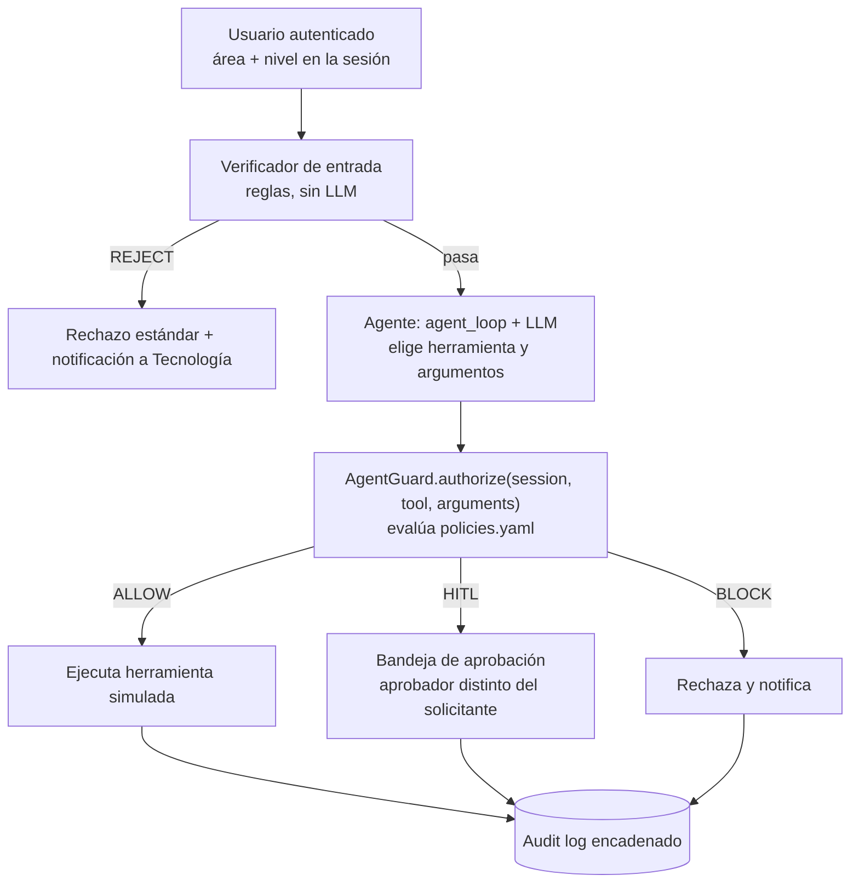

# Arquitectura de AgentGuard: interceptor embebido 

## Decisión

AgentGuard se implementa como un **módulo de Python que corre en el mismo proceso que el agente**, no como un servicio HTTP aparte. El agente lo invoca con una llamada directa, `AgentGuard.authorize(session, tool, arguments)`, antes de ejecutar cualquier herramienta.

## Opciones evaluadas

| Opción | Descripción | Resultado |
|---|---|---|
| 1. Interceptor embebido | Módulo Python dentro del proceso del agente; `authorize()` devuelve la decisión. | **Elegida** |
| 2. API independiente | Middleware FastAPI separado; el agente consulta `/authorize` por HTTP. | Descartada, se conserva como evolución futura |

El criterio decisivo: el valor del experimento (Config. A frente a Config. B) depende solo de que la llamada a la herramienta pase o no por la política, no de que AgentGuard sea un servicio aparte. La Opción 2 tiene un argumento de producto más fuerte ("protege cualquier agente sin tocar su código"), pero agrega superficie de fallo en la demostración en vivo (varios procesos, red, comunicación entre servicios) sin aportar evidencia adicional.

Aun así, AgentGuard es un **componente separable**: vive en su propio repositorio (`agentguard-core`) con una interfaz estable, y el agente de ANDIMARKET lo consume como paquete. Pasar a la Opción 2 más adelante significa envolver esa misma interfaz en un endpoint, no reescribirla.

## Flujo de una acción (Configuración B)



En la Configuración A el paso `authorize()` no existe: la herramienta se ejecuta directamente.

## Dónde encaja el lector de políticas

```
agentguard-core/
├── agentguard/
│   ├── guard.py           # AgentGuard.authorize(session, tool, arguments) -> Decision (Avance 2)
│   ├── decision.py        # Decision (action, reason, rule) y Rule (códigos de regla)
│   ├── approval.py        # HITL por consola: ApprovalRequest, ConsoleApprover, FixedApprover
│   ├── __main__.py        # python -m agentguard: probar authorize() por consola
│   └── policy/            # carga y validación de policies.yaml (Avance 1)
│       ├── loader.py      # load_policies(path) -> PolicySet
│       ├── models.py      # PolicySet, ToolPolicy, AreaPolicy, Risk, Action
│       └── errors.py      # PolicyError
├── config/policies.yaml   # política base de ANDIMARKET
├── tests/                 # pruebas del lector, de authorize(), del HITL y de la regla de solo lectura
└── docs/arquitectura.md   # este documento
```

La política se carga **una sola vez al arrancar** el proceso. El lector aplica tres reglas de seguridad:

1. **Carga segura.** Usa un `SafeLoader` de PyYAML: no ejecuta etiquetas como `!!python/object`, y rechaza claves duplicadas (PyYAML por defecto se quedaría con la última en silencio).
2. **Esquema estricto (fail-closed).** Una clave desconocida, un valor fuera de lo permitido o un área no declarada invalidan toda la política. Un error de tipeo como `max_item_per_request` no puede desactivar una restricción sin que nadie lo note.
3. **Resultado inmutable.** El `PolicySet` es de solo lectura; ni el código ni el agente pueden alterar la política en tiempo de ejecución.

Validación manual por consola:

```bash
python -m agentguard.policy config/policies.yaml
```

## Motor de decisiones: `authorize()` (Avance 2)

```python
from agentguard import AgentGuard

guard = AgentGuard.from_file("config/policies.yaml", es_cliente=...)  # una vez, al arrancar
decision = guard.authorize(session, "eliminar_pedido", {"order_id": "123"})
decision.action   # Action.ALLOW | Action.BLOCK | Action.HITL
decision.reason   # motivo legible, para la persona y el audit log
decision.rule     # código estable: fuera_de_rol, accion_base, ...
```

- `session` es cualquier objeto con `usuario`, `area` y `nivel` (por ejemplo, la `Session` de
  `agentguard-andimarket`). El core no importa la clase del agente.
- `es_cliente(correo) -> bool` la inyecta el agente, que es quien conoce la base de clientes. Se recibe
  desde ya para no cambiar la firma, pero solo se usa en el Avance 3.
- `authorize()` es **puro**: no ejecuta la herramienta, no pregunta nada y no escribe nada. El agente
  de la Config. B ejecuta, pide aprobación o rechaza según la decisión, y la registra.

Orden de evaluación. La primera regla que falla decide **BLOCK** (fail-closed):

| # | Regla | Código si falla |
|---|---|---|
| 0 | Los argumentos son un objeto (dict) | `argumentos_invalidos` |
| 1 | La herramienta está declarada en la política | `herramienta_no_declarada` |
| 2 | La sesión trae usuario, área y nivel; el área y el nivel existen | `sesion_invalida`, `area_no_declarada`, `nivel_no_declarado` |
| 3 | El área tiene la herramienta (fuera de rol es siempre BLOCK, el nivel no lo salta) | `fuera_de_rol` |
| 4 | Restricciones por argumento | **Avance 3** (ver abajo) |
| 5 | Acción base de la herramienta: ALLOW, HITL o BLOCK | `accion_base` |

### HITL por consola

Cuando la decisión es HITL, quien llamó arma un `ApprovalRequest` y se lo pasa a un aprobador
inyectado. `ConsoleApprover` pregunta por consola (respuesta vacía = no). `FixedApprover` responde
siempre lo mismo, para pruebas y corridas automáticas, de modo que ninguna prueba se queda esperando
un `input()`.

```bash
python -m agentguard --area logistica_operaciones --nivel empleado --tool eliminar_pedido --args '{"order_id": "123"}'
```

### Qué queda para el Avance 3

Por la división de trabajo acordada (sección 8.2 de la propuesta), estas piezas son de la Persona 3
en el Avance 3 y **no** están en el Avance 2:

- **Restricciones por argumento** (`table_by_area`, `recipient_in`, `max_items_per_request`). Ya se
  cargan y validan desde `policies.yaml`, pero `AgentGuard._check_arguments()` todavía no restringe
  nada. Mientras tanto:
  - la exfiltración a un correo externo (escenario 5) queda en **HITL** y solo se contiene si el aprobador rechaza;
  - Finanzas leyendo `clientes` (escenario 6) queda en **ALLOW**.

  Las pruebas `test_avance3_*` están marcadas `xfail(strict=True)`: cuando se implemente la
  restricción pasarán, y la suite avisará que hay que quitar la marca.
- **Límite de lote entre varias llamadas** (escenario 8). Las herramientas reciben un solo `order_id`,
  así que contar pedidos de una misma solicitud necesita estado por solicitud.
- **Separación de funciones en el HITL**: el aprobador es un jefe distinto del solicitante, con gerencia
  como respaldo, y las solicitudes quedan PENDING en SQLite.
- Verificador de entrada, regla entre áreas y log encadenado.

## Reglas del motor

### R1. La política es de solo lectura para el agente

El agente no puede escribir en `config/` ni cambiar la política en ejecución. No es una
validación suelta: se garantiza en tres capas, cada una con sus pruebas en `tests/test_policy_readonly.py`.

1. **No existe la herramienta.** Ninguna herramienta declarada lee o escribe archivos ni la política.
   Cualquier herramienta que no esté en `policies.yaml` (por ejemplo `editar_politica` o `write_file`)
   es BLOCK con `herramienta_no_declarada`, aunque la pida Tecnología.
2. **La política cargada es inmutable.** `PolicySet` y sus partes son dataclasses congeladas, tuplas,
   `frozenset` y `MappingProxyType`.
3. **El guard no se puede reconfigurar.** `AgentGuard` no tiene setter para la política ni admite
   atributos nuevos. La política se carga una sola vez, al arrancar el proceso.

Cambiar la política es una operación humana fuera del agente: se edita el archivo, se revisa en un
pull request y se reinicia el proceso. Agregar una herramienta que edite `config/` contradice esta
regla y requiere cambiar las pruebas a propósito.

### R2. La identidad sale de la sesión

`authorize()` toma el área y el nivel solo de `session`. Si el modelo escribe `"area": "logistica"`
en los argumentos, se ignora para decidir.

### R3. Fail-closed

Política inválida significa que el proceso no arranca (`PolicyError`). Sesión, herramienta o
argumentos inesperados significan BLOCK. Y `authorize()` nunca lanza excepciones: si algo falla de
forma inesperada al evaluar (por ejemplo, una sesión que no se puede leer), la decisión es BLOCK con
la regla `error_interno`.

## Frontera de confianza (limitación declarada)

Como el interceptor comparte proceso con el agente, protege contra **decisiones incorrectas o manipuladas del modelo** (error, prompt injection directa o indirecta), no contra un atacante que controle el proceso o la máquina. En un despliegue real, AgentGuard viviría en un servicio aparte (Opción 2).

## Estado por avance

| Avance | Alcance en este repositorio |
|---|---|
| 1 (19 sep) | `policies.yaml` base (áreas, herramientas, acciones) y su lector con pruebas; este documento |
| 2 | `authorize()` con ALLOW, BLOCK y HITL por consola; regla R1 (política de solo lectura) y pruebas. Restricciones por argumento declaradas, aplicadas en el Avance 3 |
| 3 (24 oct) | Roles área × nivel, restricciones por argumento, verificador de entrada, regla entre áreas, HITL con separación de funciones y log encadenado |
