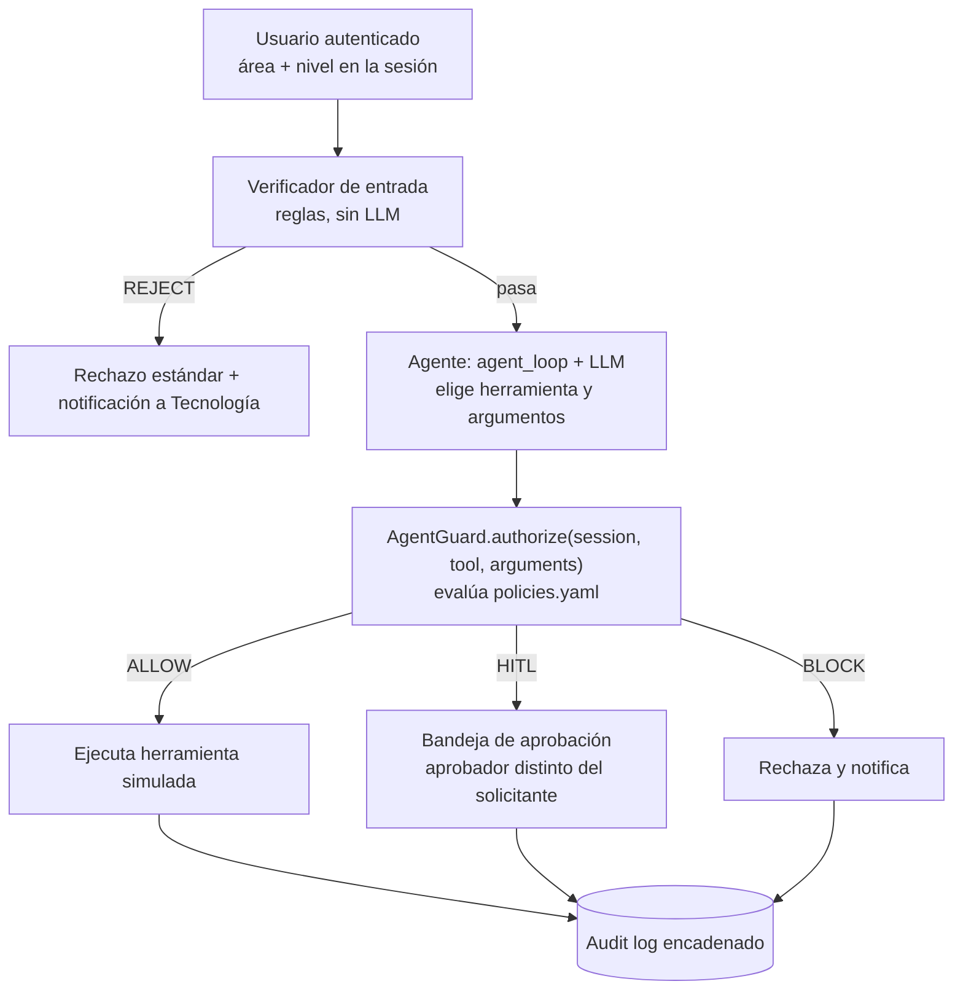

# Arquitectura de AgentGuard: interceptor embebido 

## Decisión

AgentGuard se implementa como un **módulo de Python que corre en el mismo proceso que el agente**, no como un servicio HTTP aparte. El agente lo invoca con una llamada directa, `AgentGuard.authorize(session, tool, arguments)`, antes de ejecutar cualquier herramienta.

## Opciones evaluadas

| Opción | Descripción | Resultado |
|---|---|---|
| 1. Interceptor embebido | Módulo Python dentro del proceso del agente; `authorize()` devuelve la decisión. | **Elegida** |
| 2. API independiente | Middleware FastAPI separado; el agente consulta `/authorize` por HTTP. | Descartada, se conserva como evolución futura |

El criterio decisivo: el valor del experimento (Config. A frente a Config. B) depende solo de que la llamada a la herramienta pase o no por la política, no de que AgentGuard sea un servicio aparte. La Opción 2 tiene un argumento de producto más fuerte ("protege cualquier agente sin tocar su código"), pero agrega superficie de fallo en la demostración en vivo (varios procesos, red, comunicación entre servicios) sin aportar evidencia adicional.

Aun así, AgentGuard es un **componente separable**: vive en su propio repositorio (`agentguard-core`) con una interfaz estable, y el agente de ANDIMARKET lo consume como paquete. Pasar a la Opción 2 más adelante significa envolver esa misma interfaz en un endpoint, no reescribirla.

## Flujo de una acción (Configuración B)



En la Configuración A el paso `authorize()` no existe: la herramienta se ejecuta directamente.

## Dónde encaja el lector de políticas

```
agentguard-core/
├── agentguard/policy/     # carga y validación de policies.yaml (Avance 1)
│   ├── loader.py          # load_policies(path) -> PolicySet
│   ├── models.py          # PolicySet, ToolPolicy, AreaPolicy, Risk, Action
│   └── errors.py          # PolicyError
├── config/policies.yaml   # política base de ANDIMARKET
├── tests/                 # pruebas del lector
└── docs/arquitectura.md   # este documento
```

La política se carga **una sola vez al arrancar** el proceso. El lector aplica tres reglas de seguridad:

1. **Carga segura.** Usa un `SafeLoader` de PyYAML: no ejecuta etiquetas como `!!python/object`, y rechaza claves duplicadas (PyYAML por defecto se quedaría con la última en silencio).
2. **Esquema estricto (fail-closed).** Una clave desconocida, un valor fuera de lo permitido o un área no declarada invalidan toda la política. Un error de tipeo como `max_item_per_request` no puede desactivar una restricción sin que nadie lo note.
3. **Resultado inmutable.** El `PolicySet` es de solo lectura; ni el código ni el agente pueden alterar la política en tiempo de ejecución.

Validación manual por consola:

```bash
python -m agentguard.policy config/policies.yaml
```

## Frontera de confianza (limitación declarada)

Como el interceptor comparte proceso con el agente, protege contra **decisiones incorrectas o manipuladas del modelo** (error, prompt injection directa o indirecta), no contra un atacante que controle el proceso o la máquina. En un despliegue real, AgentGuard viviría en un servicio aparte (Opción 2).

## Estado por avance

| Avance | Alcance en este repositorio |
|---|---|
| 1 (19 sep) | `policies.yaml` base (áreas, herramientas, acciones) y su lector con pruebas; este documento |
| 2 (26 sep) | `authorize()` con ALLOW, BLOCK y HITL por consola; protección de `config/` contra escritura del agente |
| 3 (24 oct) | Roles área × nivel, restricciones por argumento, verificador de entrada, regla entre áreas, HITL con separación de funciones y log encadenado |
